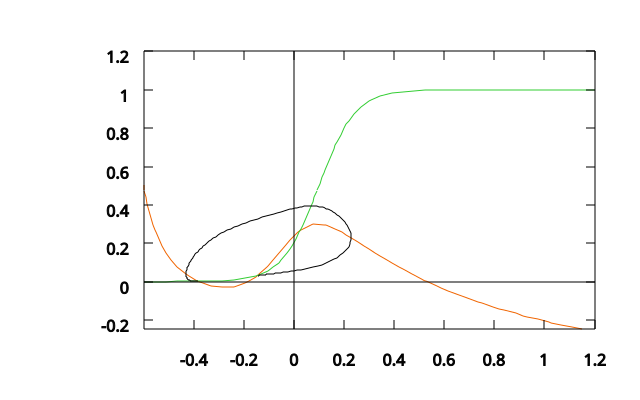
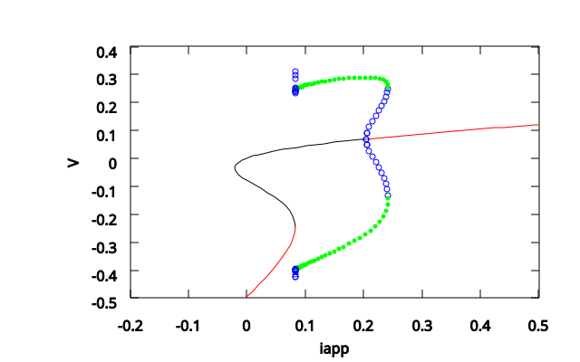
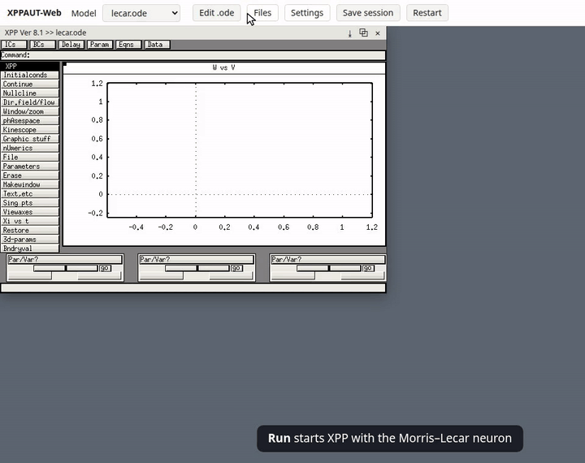
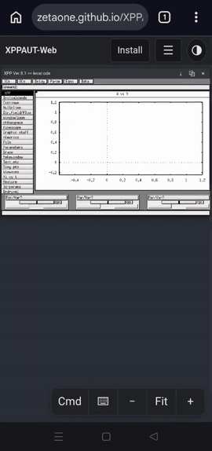

# XPPAUT-Web

**Author:** Jeevan Kumar Gochhayat

XPPAUT, the dynamical-systems tool by Bard Ermentrout, running in the browser.
Same program, same interface, nothing to install.

**→ https://zetaone.github.io/XPPAUT-Web/**

This page as a PDF, to print or pass on: [**XPPAUT-Web-README.pdf**](https://zetaone.github.io/XPPAUT-Web/XPPAUT-Web-README.pdf)

<p>
  
  
</p>

*Morris-Lecar (`lecar.ode`), exported as SVG from XPPAUT-Web. Left: limit cycle
and nullclines in the V–W plane. Right: AUTO continuation in `iapp`, with
steady states (red stable, black unstable) and periodic orbits from the Hopf
point (green stable, blue unstable).*

## Video tour

<p>
  <a href="https://zetaone.github.io/XPPAUT-Web/videos/tour.mp4"></a>
  <a href="https://zetaone.github.io/XPPAUT-Web/videos/tour-phone.mp4"></a>
</p>

*Left: on a computer. Right: on a phone (the Cmd panel, then Integrate and
Last). Click a preview to play the full 2-minute video.*

## Features

- **The real XPPAUT 8**: its C code compiled to WebAssembly. Windows match the
  desktop version pixel for pixel.
- **AUTO** for steady states, periodic orbits and bifurcation diagrams.
- **212 example models** from the XPPAUT release, or your own `.ode` file with
  its `.ani`, `.tab` and `.dat` files (pick them together, or drag and drop
  them onto the page; a model whose table file is missing asks for it).
- **Window panels**: drag, resize, close, save as PNG, or pop out into a
  separate browser window. Windows are also easier to close than on the desktop.
- **Exports**: PostScript, SVG, data and `.set` files download automatically,
  or go to a folder you choose.
- **Save session**: one `.zip` with all files, screenshots of every window and
  XPP's output, offered before you restart or quit.
- **Phones**: detected automatically, with touch controls
  (see [below](#phones)).
- **Install as an app**: its own icon and window, works offline, and offers
  updates when a new version is published (see [below](#install-as-an-app)).
- **Model editor**, **XPP's terminal output**, **built-in help**, and
  **ten colour themes**.
- **Fast and private**: about 0.5 MB, near-native speed, and nothing leaves
  your browser.

## Quick start

1. Choose an example and press **Run**, or **Open .ode file…** (or drop your
   `.ode` file on the page) together with the table and data files it uses.
   XPP looks for them in its own folder, shown under **Files**.
2. Use XPP as on the desktop: **I G** integrates, **N N** draws nullclines,
   **F A** opens AUTO.
3. **Save session** keeps everything; **Settings** sets where exports and output go.

Link straight to a model: `https://zetaone.github.io/XPPAUT-Web/?ode=ode/lecar.ode`

## Browsers

Nothing to install at all: the site runs in any current desktop browser.
Chrome and Edge get the fastest build; other browsers load a compatible
fallback. Tested in Chrome, Edge, Firefox and Brave.

> **Separate windows:** XPP windows opened in their own browser windows
> (**Settings → Separate windows**, or ⧉ on a window) are pop-ups. Allow
> pop-ups for this site in your browser for seamless use.

## Phones

The phone layout is chosen automatically (switch it under **Settings → View**).

- **Touch**: tap = click, drag = drag, long-press = right click. Pinch to zoom,
  two fingers to pan; **Fit** fits the window to the screen.
- **Cmd**: XPP's commands, one tap each, including its Numerics menu and,
  when the AUTO window is in front, AUTO's commands (Run, Grab, Axes, …).
  **Tap to start** starts a trajectory wherever you tap the graph;
  **Fixed point here** finds the equilibrium near your tap and shows its
  stability and eigenvalues;
  **Sliders** gives large sliders for parameters (XPP re-runs as you move
  one); **Share graph**, **Data (CSV)** and **Share .ode** export in one tap.
- **Hold a finger** on a window to magnify what is under it, with the
  graph's coordinates (also on AUTO's bifurcation diagram).
- **Landscape**: the whole window fits the screen, with the controls at the
  sides. **Settings → Rotation** can lock portrait or landscape (in the
  Android app, or when installed).
- The start screen lists your **recent models**.
- **Stop** appears while XPP computes. If the phone closes the page in the
  background, the start screen offers to **restore** the model, its files
  and the parameter values.
- **⌨** opens the keyboard together with the keys phones lack: Esc, Tab, Ctrl,
  the arrows, symbols and the model's parameter and variable names. For XPP's keyboard commands, **Gboard** (Google's keyboard)
  gives the best results; other keyboards may miss or delay keys.
- **Esc** without a keyboard: a two-finger tap, or Android's Back gesture.
- Each XPP window gets a **tab** in the toolbar; **☰** holds Files, Edit .ode,
  Settings, Save session and Restart.

> **Note: heavy simulations are not tested on phones.** Phones have less memory
> and slower processors than computers, and mobile browsers may reload a page
> that uses too much memory, losing unsaved work. Long integrations (large
> `total`, small `dt`), stiff or large systems (hundreds of variables, e.g.
> networks and arrays), large storage (`maxstor`) and long AUTO continuations
> (large `NMAX` or `NTST`) may be slow or fail. Use **Save session** often, or
> run such models on a computer.

## Install as an app

Installed, XPPAUT-Web opens in its own window from an icon, works offline, and
shows **Update** when a new version is published.

- **Android** (Chrome): tap **Install** in the toolbar, or Chrome's menu **⋮ →
  Install app** (or **Add to Home screen**).
- **Computer** (Chrome, Edge): **Install** in the toolbar, or the install icon
  in the address bar.
- **iPhone and iPad** (Safari): **Share → Add to Home Screen**. *Not tested
  yet.*

## Android app (in development)

[**Download XPPAUT-1.2-dev.apk**](https://github.com/ZetaOne/XPPAUT-Web/releases/download/android-1.2-dev/XPPAUT-1.2-dev.apk)
(13 MB, Android 10 or newer). Open it on the phone and allow installing from
that app when Android asks. It updates an earlier version in place.

> **In development.** The app works, but it is still being finished.
> **Voice commands are not very advanced yet**: expect some phrases to be
> misheard or not understood.

The website in an app, working offline, plus:

- **Open with XPPAUT** for `.ode` files from other apps; files and session
  `.zip`s are saved in **Downloads/XPPAUT**, with Share.
- **Back** = Esc, and the screen stays on while XPP computes.
- **.ode editor** that checks the model with XPP's own parser as you type.
- **Voice control (🎤)**: XPP's commands, setting values ("set gk to 2.5"),
  your Cmd panel's buttons and your own phrases, and dictating `.ode` lines.
  It uses the phone's own speech recognition by default, or an offline model
  (about 40 MB, downloaded once) on phones without one or when chosen in
  Settings → Voice.

## Download for your computer (no internet needed)

**Chrome, Edge, Brave:** the simplest way is the install icon at the right of
the address bar (a small screen with a downward arrow), or **Install** in the
toolbar. This keeps XPPAUT-Web on your computer: it opens from its own icon,
works offline, and updates itself (see [Install as an app](#install-as-an-app)).

**Save page as…** (Ctrl+S / ⌘S) does **not** work: a browser will not run XPP
from a saved page. For a copy you keep as a file, or for other browsers, use
one of these two downloads (rebuilt with every update):

- [**XPPAUT-Web.html**](https://github.com/ZetaOne/XPPAUT-Web/releases/download/offline/XPPAUT-Web.html)
  (about 2 MB): the whole program in one file. Double-click it and it opens
  in your browser. Nothing to install. Help pages open in a window of their own.
- [**XPPAUT-Web-offline.zip**](https://github.com/ZetaOne/XPPAUT-Web/releases/download/offline/XPPAUT-Web-offline.zip)
  (about 2 MB): the site as files, with a small local web server to start it.
  Unzip it and double-click **Start XPPAUT (Mac).command** (the first time:
  right-click → Open), **Start XPPAUT (Windows).bat**, or run `start-linux.sh`.
  It opens at `http://localhost:8765/` and works exactly like the website,
  including **Install** as an app. Needs Python 3 on Mac and Linux (on
  Windows it uses Python if present, otherwise PowerShell).

Both run the same XPP as the website. Tested in Chrome and Firefox; other
current browsers (e.g. Safari 16.4 or later) should work too.

## Report a bug or give feedback

Email **jeevancodes8580@gmail.com**, or
[open an issue](https://github.com/ZetaOne/XPPAUT-Web/issues) on GitHub.
Please mention your device and browser, and if a model misbehaves, attach the
`.ode` file and any files it uses (`.tab`, `.dat`, `.ani`, ...).

## Host it yourself or build from source

### Host it yourself (locally or on a server)

No build needed: XPPAUT-Web is a static site, and XPP always runs in each
visitor's own browser, so the server only hands out files (no computing, no
software to install, nothing sent back).

- **On a web page** (e.g. a course or university page): upload
  [**XPPAUT-Web.html**](https://github.com/ZetaOne/XPPAUT-Web/releases/download/offline/XPPAUT-Web.html)
  and link to it. Visitors click it and XPP runs. Your copy does not update
  itself: upload a newer one to get new features, or link to this site instead.
- **The full site** (with Install as an app and offline use): unzip
  [**XPPAUT-Web-offline.zip**](https://github.com/ZetaOne/XPPAUT-Web/releases/download/offline/XPPAUT-Web-offline.zip)
  and put the contents of its `site/` folder on any static web server (Apache,
  nginx, GitHub Pages, ...), in any folder. The server should send `.wasm` as
  `application/wasm` and `.mjs` as `text/javascript`; installing as an app
  needs HTTPS (or `localhost`).
- **On your own computer**: the zip's start scripts serve the site at
  `http://localhost:8765/` (see [Download for your computer](#download-for-your-computer-no-internet-needed)).

### Build from source

Only needed to change the code. Tested on **Linux (Ubuntu 24.04)**; macOS
should work but is untested; on Windows, use WSL (Ubuntu).

Requirements: `git`, `bash`, `make`, Python 3, and Node.js 22 or newer. The
script below downloads Emscripten (about 1 GB) into `.emsdk/` inside the project.

```bash
git clone https://github.com/ZetaOne/XPPAUT-Web.git && cd XPPAUT-Web
scripts/setup-emsdk.sh             # Emscripten, once
npm install
npm run build:wasm                 # compile XPP; copy examples and help
npm run dev                        # open http://localhost:5173/
```

`npm run build` writes the static site to `dist/`. Pushes to `master` are built
and deployed to GitHub Pages automatically.

**Tests** (Linux): compare with the desktop XPPAUT. Extra packages:
`sudo apt install build-essential libx11-dev xvfb xdotool imagemagick python3-pil`.

```bash
scripts/build-native.sh && scripts/test-native.sh   # desktop reference build
scripts/compare-batch.sh build/headless-cc/xppaut   # numerical results
scripts/compare-gui.sh tests/gui/*.txt              # screenshots vs desktop XPP
```

## How it works

The XPPAUT source is compiled with Emscripten. XPP draws its own interface with
X11, so `web/xlib/` reimplements the 69 X11 calls it uses, and the page
(`src/`) shows each X window as a canvas. For more details, with diagrams, see
[**How XPPAUT-Web works** (PDF)](docs/how-it-works.pdf).

## Licence

**GNU General Public License v2**
([Ermentrout/xppaut](https://github.com/Ermentrout/xppaut)); its source files
also permit any later version. See [`LICENSE`](LICENSE).

- XPPAUT © 2002–2017 Bard Ermentrout & Daniel Dougherty.
  [Homepage](https://sites.pitt.edu/~phase/bard/bardware/xpp/xpp.html).
- It includes AUTO (E. J. Doedel) and CVODE (S. D. Cohen & A. C. Hindmarsh, LLNL).
- Changes to the XPPAUT source for this port: [`xppaut/UPSTREAM.md`](xppaut/UPSTREAM.md).
- The site icon is taken from the plot in the XPPAUT homepage banner.
