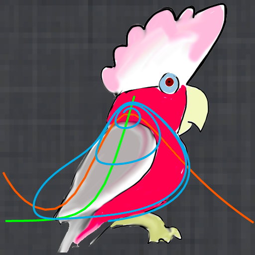
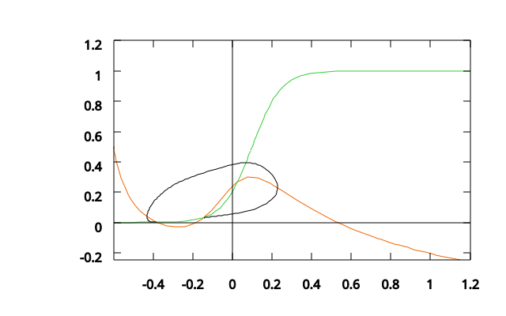
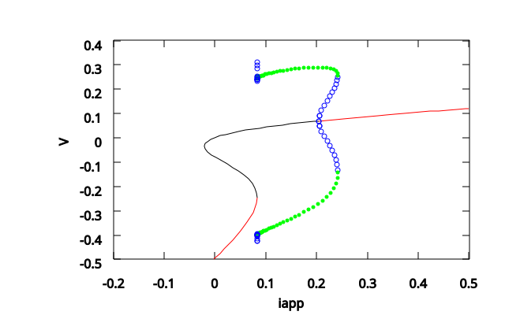
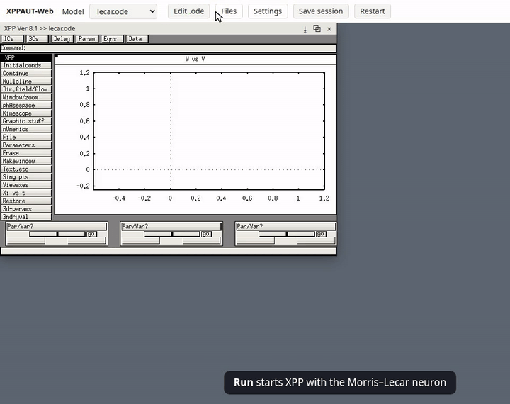
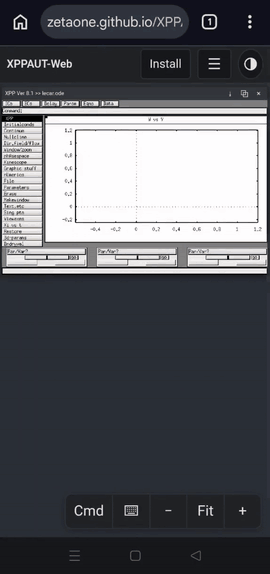
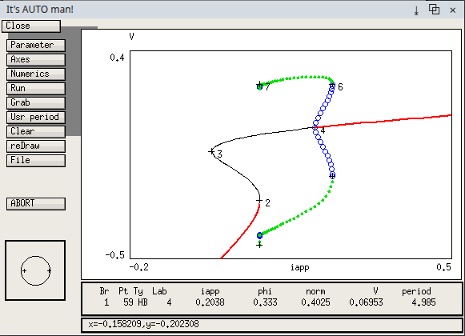
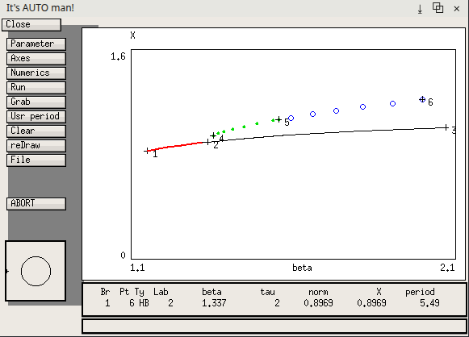
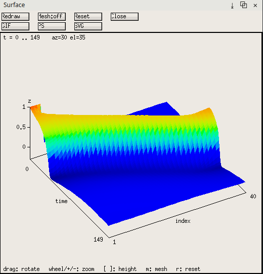
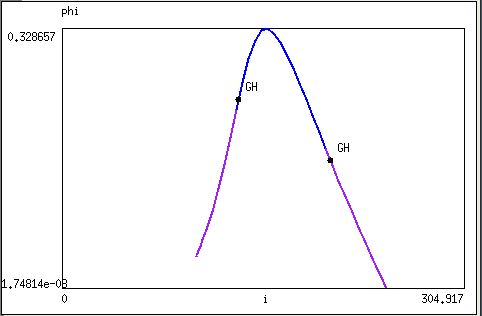

# XPPAUT-Web



**Author:** Jeevan Kumar Gochhayat

XPPAUT, the dynamical-systems tool by Bard Ermentrout, running in the browser.
Same program, same interface, nothing to install.

**→ https://zetaone.github.io/XPPAUT-Web/**

*Icon: picture by Bard Ermentrout, from the XPPAUT apps for iPad and iPhone.*

This page as a PDF, to print or pass on: [**XPPAUT-Web-README.pdf**](https://zetaone.github.io/XPPAUT-Web/XPPAUT-Web-README.pdf)

<p>
  
  
</p>

*Morris-Lecar (`lecar.ode`), exported as SVG from XPPAUT-Web. Left: limit cycle
and nullclines in the V–W plane. Right: AUTO continuation in `iapp`, with
steady states (red stable, black unstable) and periodic orbits from the Hopf
point (green stable, blue unstable).*

## Video tour

<p>
  <a href="https://zetaone.github.io/XPPAUT-Web/videos/tour.mp4"></a>
  <a href="https://zetaone.github.io/XPPAUT-Web/videos/tour-phone.mp4"></a>
</p>

*Left: on a computer. Right: on a phone (the Cmd panel, then Integrate and
Last). Click a preview to play the full 2-minute video.*

## Features

- **The real XPPAUT 8.4**: its C code compiled to WebAssembly. Windows match the
  desktop version pixel for pixel. See what is new in
  [8.4](#new-in-xppaut-84-scripting), [8.2](#new-in-xppaut-82)
  and [8.1](#new-in-xppaut-81).
- **AUTO** for steady states, periodic orbits and bifurcation diagrams, now also
  of delay equations.
- **228 example models** from the XPPAUT release and for the new 8.1, 8.2 and 8.4 features, or your own `.ode` file with
  its `.ani`, `.tab`, `.dat` and `.xps` (script) files (pick them together, or drag and drop
  them onto the page; a model whose table file is missing asks for it).
- **Window panels**: drag, resize, close, save as PNG, or pop out into a
  separate browser window. Windows are also easier to close than on the desktop.
- **Exports**: PostScript, SVG, data and `.set` files download automatically,
  or go to a folder you choose.
- **Save session**: one `.zip` with all files, every graph window and the AUTO
  diagram as SVG and PostScript (made by XPP itself), AUTO's data
  (`diagram.dat`, `allinfo.dat` and the `.auto` file, as its File menu writes
  them), the plotted data (each graph's curves, frozen curves, nullclines and
  direction field), screenshots of every window (also ones you closed), XPP's
  state as a `.set` file, the data as CSV, XPP's output, and `summary.txt` with
  what XPP's result windows said (messages such as the period, the Equilibria
  window of Sing pts) and the results it printed; offered before you restart
  or quit.
- **Phones**: detected automatically, with touch controls
  (see [below](#phones)), and [voice commands](#voice-commands).
- **Install as an app**: its own icon and window, works offline, and offers
  updates when a new version is published (see [below](#install-as-an-app)).
- **Code editor** in its own tab ([below](#editor)), **XPP's terminal
  output**, **built-in help**, and **ten colour themes**.
- **Fast and private**: about 0.5 MB, near-native speed, and nothing leaves
  your browser.

## New in XPPAUT 8.4: scripting

**Latest from Bard Ermentrout (21 November 2026):** scripts can now be
**recorded** (File → **recOrd script**: XPP writes what you do as a script,
ready to run again; the same menu entry stops it); the **Lyapunov
exponents** (Numerics → stocHast → Liapunov) give the complete spectrum for
systems of fewer than 8 equations, computed in double precision with their
own adaptive integrator, with error estimates, the check that their sum
equals the flow's divergence, and the Kaplan–Yorke dimension; small fixes;
and Bard's manual, updated after 12 years:
[xpp_doc.pdf](https://zetaone.github.io/XPPAUT-Web/help/xpp_doc.pdf).

**23 November 2026:** a fix to AUTO, found by the author of XPP-Lab: after
**Clear grab**, a new diagram started next to an old one now numbers its
points after the old ones, instead of starting again at label 1 (so no two
points share a label). Example: `lecar-two-diagrams.xps`. Saved diagrams now
keep every digit.

XPPAUT 8.4 (November 2026) can run **scripts**: plain text files (`.xps`) of
commands that XPP carries out for you, for reproducing a figure exactly, for a
tutorial with pauses, or for a parameter sweep. Bard Ermentrout's manual:
[script_doc.html](https://zetaone.github.io/XPPAUT-Web/help/script_doc.html).

```
set iapp=.15        # parameters, initial conditions, numerics, plot options
keys n n            # menu keys: Nullcline -> New
keys d s            # Dir.field/flow -> Scaled Dir.Fld
ans 16              # the answer to the dialog that opens (grid size)
keys i g            # Initialconds -> Go
shot pp.ps          # save the picture (.ps or .svg), no dialogs
```

- **Commands**: `set`, `keys`, `ans` / `ok` / `cancel` for dialogs, `click`
  and `drag` for the mouse in the plot (in the plot's own coordinates),
  `msg`, `pause` (Enter or Space goes on, Esc stops), `wait`, `speed`, and
  `shot` to save a picture.
- **AUTO**: `autokeys` presses keys in the AUTO window, `auto goto HB 1`
  selects a point of the diagram (as Grab + Enter would), `auto list` prints
  the labelled points, and `shot auto file.ps` saves the diagram.
- **Loops and errors**: `for a in 1 2 3 ... end`, `for k = 0:0.5:2`,
  `repeat 3`, with `$a` in any line (also file names); `try ... else ... end`
  carries on when a command fails.
- **Running a script**: when XPP's folder has scripts (an example that comes
  with them, or a folder or files you open that include `.xps` files), a
  **Scripts** menu appears at the top of the page, listing each script with
  **Run** and **Edit**. It is easier to use than XPP's own small file
  selector, above all on phones: there it is in the ☰ menu, and **Scripts…**
  is the last button of the Cmd panel. XPP's File → **Do script** (keys F D;
  also under More… in the Cmd panel) works too. A link can also run a script
  as soon as the model opens:
  [`?ode=bard-renew/lecar.ode&script=lecar-nullclines.xps`](https://zetaone.github.io/XPPAUT-Web/?ode=bard-renew/lecar.ode&script=lecar-nullclines.xps).
- **Writing scripts**: **New script** (under **Files**, and in the Scripts
  menu) and **Edit** open a script editor, like Edit .ode. **Save and run**
  runs it at once; no restart is needed. **Add scripts…** (or Open .ode
  file… and Add files…) brings in your own `.xps` files.
- **Pictures as PNG**: in XPPAUT-Web, `shot fig.png` (or `shot auto fig.png`)
  saves the graph (or the AUTO diagram) as it is on screen, at twice the
  size, ready to view on a phone. Desktop XPPAUT saves `.ps` or `.svg`.
- **Examples**: the group **bard-renew**, first in the Model list, with what
  scripts do best: work that would take many clicks and dialogs by hand, done
  the same way every time.
  - `hh.ode` (Hodgkin–Huxley): an f–I sweep, eight currents one after
    another and three of them on one plot (`hh-fi.xps`); a lecture with pauses on bistability at I = 8, where the
    same neuron rests or fires for ever depending on one kick
    (`hh-bistable.xps`); and AUTO from start to finish: Hopf points at
    I = 9.78 and 154.5 and the periodic orbits with their fold at I = 6.26
    (`hh-auto.xps`).
  - `wc.ode` (Wilson–Cowan): phase portraits for six inputs with clicked
    starting points (`wc-portraits.xps`); a lecture with
    pauses (`wc-lecture.xps`); and AUTO with AUTO's own forms filled in by
    label: steady states, the Hopf point and folds, the periodic orbits, and
    two-parameter curves of the Hopf point (both directions, with a
    generalised Hopf point) and of a fold (`wc-auto.xps`).
  - `lecar.ode` (Morris–Lecar) with seven shorter scripts, including Bard's
    example above, scripted mouse clicks, AUTO diagrams (also two in one
    window, `lecar-two-diagrams.xps`), and one made with the recorder
    (`lecar-recorded.xps`).
  - `lorenz.ode` (Lorenz): the full **Lyapunov spectrum** in one script
    (`lorenz-lyapunov.xps`): about 0.86, 0 and −14.51, summing to the flow's
    divergence −13.667, Kaplan–Yorke dimension 2.06.
  - `hutch.ode` (Hutchinson delay equation): an AUTO sweep over three
    starting values that carries on when a pass has no Hopf point
    (`try … else … end`), with the periodic orbits from each Hopf point
    (`hutch-try.xps`; saves `hutch-try.svg`, and runs unchanged in desktop
    XPPAUT 8.4).

  The Hodgkin–Huxley and Wilson–Cowan scripts each save one picture at the
  end, as PNG (the Hutchinson one as SVG); everything a script saves is in XPP's folder (**Files**, or
  Save session).

<p>
  
</p>

*`lecar-auto.xps` in XPPAUT-Web: steady states, the first Hopf point
(iapp = 0.2038), and the periodic orbits from it, computed and saved by the
script.*

## New in XPPAUT 8.2

XPPAUT 8.2 (November 2026) added the following.
Pick the examples under **New in XPPAUT 8.2** in the Model list to try it;
their comments give the steps and the values to expect.

- **Bifurcation analysis of delay equations** in AUTO. Steady states and their
  stability (from the delay equation's own characteristic equation), Hopf
  points, periodic orbits started from a Hopf point or from a simulation,
  their stability (Floquet multipliers), period doublings and the
  period-doubled branch, and two-parameter curves of Hopf points, period
  doublings, folds and torus bifurcations. The examples are Mackey–Glass,
  Hutchinson, a Wilson–Cowan pair, two coupled neurons, delay-coupled
  Stuart–Landau oscillators, and equations with two delays. Delay equations
  are also integrated in a new way, so their simulations can differ slightly
  from XPPAUT 8.1.
- **Surface plot** of an array plot: the **Surface** button shows the array
  plot's data as a 3-D surface. Drag to rotate, use the wheel (or + and −) to
  zoom, and save it as GIF, PostScript or SVG. Save session puts it in
  `figures/` while the Surface window is open.
- **Window close buttons**: the × on every XPP window works (it presses the
  window's own Close or Cancel button; on the main window it asks first).
  Buttons look raised and light up under the mouse.

<p>
  
  
</p>

*Left: Mackey–Glass (`mg.ode`) in AUTO: the Hopf point at β = 1.337 and the
periodic orbits from it, stable up to the period doubling at β = 1.5554491.
Right: the Surface view of `surface-cable.ode`. Both computed in XPPAUT-Web.*

## New in XPPAUT 8.1

XPPAUT 8.1 (November 2026) added the following. The examples under
**New in XPPAUT 8.1** in the Model list show them; their comments give the steps.

- **Periodic orbits made easy**: **Initialconds → (P)eriodic** finds the period
  of the cycle a run has settled onto, accurately (not limited by the stored
  points), starts at the peak of the variable on the x-axis, and sets Total to
  one period.
- **Phase reduction** (**nUmerics → Averaging**): besides the adjoint (the
  infinitesimal phase response curve), New adj now computes the **isostable
  response** I, the slowest **Floquet eigenfunction** ρ and multiplier, and the
  **correction B** to the phase response away from the cycle. Each can be
  loaded and plotted, and **(2) H2** gives the second-order interaction
  function of two coupled cells (Wilson & Ermentrout, *Phys. Rev. Lett.* 123,
  164101, 2019).
- **Hopf bifurcations in AUTO**: on a two-parameter Hopf curve, subcritical
  parts are drawn in **purple** and supercritical parts in the usual colour,
  from the first Lyapunov coefficient; **GH** marks the generalised Hopf
  (Bautin) points where it changes sign.
- **GIFs say how they were made**: every animated GIF (Kinescope, animations,
  array plots) includes the model, its parameters, the numerics and what it
  shows, as a comment (read by image tools) and as text at its end.
- AUTO's two-parameter fold and Hopf continuations start from the fold and
  Hopf conditions themselves; the Fourier transform and histograms work on any
  data in the browser (such as the adjoint); and a few fixes.

<p>
  
</p>

*The Hopf curve of Morris–Lecar (`hopf-gh.ode`) in the (i, φ) plane, computed
in XPPAUT-Web: subcritical in purple, supercritical in blue, and the two GH
points.*

## Quick start

1. Choose an example and press **Run**, or **Open .ode file…** (or drop your
   `.ode` file on the page) together with the table and data files it uses.
   XPP looks for them in its own folder, shown under **Files**.
2. Use XPP as on the desktop: **I G** integrates, **N N** draws nullclines,
   **F A** opens AUTO.
3. **Save session** keeps everything; **Settings** sets where exports and output go.

Link straight to a model: `https://zetaone.github.io/XPPAUT-Web/?ode=ode/lecar.ode`

## Browsers

Nothing to install at all: the site runs in any current desktop browser.
Chrome and Edge get the fastest build; other browsers load a compatible
fallback. Tested in Chrome, Edge, Firefox and Brave.

> **Separate windows:** XPP windows opened in their own browser windows
> (**Settings → Separate windows**, or ⧉ on a window) are pop-ups. Allow
> pop-ups for this site in your browser for seamless use.

## Phones

The phone layout is chosen automatically (switch it under **Settings → View**).

- **Touch**: tap = click, drag = drag, long-press = right click. Pinch to zoom,
  two fingers to pan; **Fit** fits the window to the screen.
- **Cmd**: XPP's commands, one tap each, including its Numerics menu and,
  when the AUTO window is in front, AUTO's commands (Run, Grab, Axes, …).
  **Tap to start** starts a trajectory wherever you tap the graph;
  **Fixed point here** finds the equilibrium near your tap and shows its
  stability and eigenvalues;
  **Sliders** gives large sliders for parameters (XPP re-runs as you move
  one); **Share graph**, **Data (CSV)** and **Share .ode** export in one tap.
- **Hold a finger** on a window to magnify what is under it, with the
  graph's coordinates (also on AUTO's bifurcation diagram).
- **Landscape**: the whole window fits the screen, with the controls at the
  sides. **Settings → Rotation** can lock portrait or landscape (in the
  Android app, or when installed).
- The start screen lists your **recent models**.
- **Stop** appears while XPP computes. If the phone closes the page in the
  background, the start screen offers to **restore** the model, its files
  and the parameter values.
- **⌨** opens the keyboard together with the keys phones lack: Esc, Tab, Ctrl,
  the arrows, symbols and the model's parameter and variable names. For XPP's keyboard commands, **Gboard** (Google's keyboard)
  gives the best results; other keyboards may miss or delay keys.
- **Esc** without a keyboard: a two-finger tap, or Android's Back gesture.
- Each XPP window gets a **tab** in the toolbar; **☰** holds Files, Edit .ode,
  Settings, Save session and Restart.

> **Note: heavy simulations are not tested on phones.** Phones have less memory
> and slower processors than computers, and mobile browsers may reload a page
> that uses too much memory, losing unsaved work. Long integrations (large
> `total`, small `dt`), stiff or large systems (hundreds of variables, e.g.
> networks and arrays), large storage (`maxstor`) and long AUTO continuations
> (large `NMAX` or `NTST`) may be slow or fail. Use **Save session** often, or
> run such models on a computer.

## Editor

**Editor** (at the top of the page) opens a code editor in a new browser tab,
working on XPP's files:

- **Web files** and **Local files**: a switch at the top of the file list.
- **Web files** are kept in the browser, **one folder per model**: what XPP
  saves while it runs a model goes into that model's folder, and XPP sees
  only that folder's files. The model opened most recently is at the top.
  Files stay between visits and are shared by XPP's tab and the editor (and
  any number of editor windows: **New window**). Drag a file onto a folder
  to move it. ⋯ next to a folder: Run, New file, Add files, Rename,
  Download (.zip), Delete. ⋯ at the top: New model, Add files, **Download
  all (.zip)**, **Restore from .zip**. Clearing the site's data deletes
  them, so download a copy of anything you want to keep.
- **Local files** is empty until you **Choose a folder** on your device;
  the folder is then remembered. Chrome and Edge on computers edit its
  files in place (the browser may ask once per visit). Other browsers
  (Firefox, Safari, phones) read a copy of it, and Save downloads the file.
  ▶ Run on a local model copies it and the files beside it into its
  folder in Web files first.
- **Two editors in one**: VS Code's editor (Monaco) on computers, a
  touch-friendly one (CodeMirror) on phones and tablets; switch in ⚙.
  Highlighting for `.ode` models and `.xps` scripts, and **live checking of
  `.ode` files by XPP itself** (errors appear as you type, in **Problems**).
- **Previews**: pictures (SVG, PNG, GIF), PDF, **PostScript** (drawn by
  Ghostscript, downloaded the first time), and data files (`.dat`, `.csv`)
  as a table with a plot.
- **▶ Run**: a model restarts XPP with it, a script runs in XPP's tab (no
  restart).
- **Like a desktop editor**: tabs, **Split** (two groups side by side; drag
  tabs between them, drag the dividers), resizable panels, ten themes (or
  the site's), font size, line wrap, minimap, save automatically,
  Ctrl/Cmd+S.

## Voice commands

Tap **🎤** (in the zoom bar on phones and tablets; on a computer it appears at
the top once a voice engine is chosen) and speak XPP's commands: “integrate”,
“nullclines”, “set i app to point one five”, “auto”, “run steady state”,
“run script nullclines”, “what can I say”. Several commands can be said in
one go: “set i app to point one five then integrate then nullclines”, or
“auto, run, enter”. The buttons of the Cmd panel work by saying their label.

- **What comes next**: after a command, the voice bar shows faintly what
  makes sense now (after “auto”: Run, Grab, Parameter, …), and words that
  sound close are understood (“graph” → Grab). Menus by name: “file”, then
  an item (“calculator”), or “file auto”.
- **Files and scripts**: in XPP's file picker, or the Scripts and Files
  panels, say a file's name; “do script” opens the Scripts panel.
- **The page**: “settings”, “files”, “next window”, “show auto”, “dark mode”,
  “theme nord”, “flash on bell on”, “show output”, “save session”,
  “load hh”.
- **Your own words**: Settings → Voice → Your own words: say a command your
  way once, and it is understood from then on (in that browser).
- A short **voice tour** the first time (Skip ends it; Settings → Voice →
  Voice tour shows it again). “What can I say” lists everything.

How speech becomes text is chosen at the first tap, or in **Settings →
Voice**:

| | Download | Internet | Notes |
|---|---|---|---|
| **Browser speech** | none (built in) | needed | Chrome sends the audio to Google, Safari to Apple. Chrome, Edge and Samsung Internet on Android, Safari on iPhone and iPad (turn on Dictation); not Firefox |
| **Vosk** | about 44 MB, once | not needed | Completely offline and private; every browser; listens for XPP's commands only |
| **Whisper** (tiny.en) | about 57 MB, once | not needed | Completely offline and private; the most accurate, but slower on phones |

A download happens only when that engine is chosen, never when the page
opens, and stays in the browser (Settings → Voice → **Delete the download**
removes it). The Android app has its own voice control.

## Install as an app

Installed, XPPAUT-Web opens in its own window from an icon, works offline, and
shows **Update** when a new version is published.

- **Android** (Chrome): tap **Install** in the toolbar, or Chrome's menu **⋮ →
  Install app** (or **Add to Home screen**).
- **Computer** (Chrome, Edge): **Install** in the toolbar, or the install icon
  in the address bar.
- **iPhone and iPad** (Safari): **Share → Add to Home Screen**. *Not tested
  yet.*

## Android app (in development)

[**Download XPPAUT-1.10-dev.apk**](https://github.com/ZetaOne/XPPAUT-Web/releases/download/android-1.10-dev/XPPAUT-1.10-dev.apk)
(13 MB, Android 10 or newer). Open it on the phone and allow installing from
that app when Android asks. It updates an earlier version in place.

The file is **13,422,867 bytes**, SHA-256
`8406a669c18220e75f7fee7b0ebd582e396ab3969c3cafcadf5e5756288b6f6c`
([checksum file](https://github.com/ZetaOne/XPPAUT-Web/releases/download/android-1.10-dev/XPPAUT-1.10-dev.apk.sha256)).
If Android says *"package appears to be invalid"*, the download is usually
incomplete: compare the size (Files app → Details) and download it again,
then open it from the Files app.

> **In development.** The app works, but it is still being finished.
> **Voice commands are not very advanced yet**: expect some phrases to be
> misheard or not understood.

The website in an app, working offline, with XPPAUT 8.4, plus:

- **Open with XPPAUT** for `.ode` files from other apps; files and session
  `.zip`s are saved in **Downloads/XPPAUT**, with Share. Save session there
  holds the same as on the website: figures, AUTO's diagram and data, the
  plotted data (curves, nullclines, direction field) and XPP's state.
- **Back** = Esc, and the screen stays on while XPP computes.
- **.ode editor** that checks the model with XPP's own parser as you type.
- **Voice control (🎤)**: XPP's commands, setting values ("set gk to 2.5"),
  your Cmd panel's buttons and your own phrases, and dictating `.ode` lines.
  It uses the phone's own speech recognition by default, or an offline model
  (about 40 MB, downloaded once) on phones without one or when chosen in
  Settings → Voice.

## Download for your computer (no internet needed)

**Chrome, Edge, Brave:** the simplest way is the install icon at the right of
the address bar (a small screen with a downward arrow), or **Install** in the
toolbar. This keeps XPPAUT-Web on your computer: it opens from its own icon,
works offline, and updates itself (see [Install as an app](#install-as-an-app)).

**Save page as…** (Ctrl+S / ⌘S) does **not** work: a browser will not run XPP
from a saved page. For a copy you keep as a file, or for other browsers, use
one of these two downloads (rebuilt with every update):

- [**XPPAUT-Web.html**](https://github.com/ZetaOne/XPPAUT-Web/releases/download/offline/XPPAUT-Web.html)
  (about 2 MB): the whole program in one file. Double-click it and it opens
  in your browser. Nothing to install. Help pages open in a window of their own.
- [**XPPAUT-Web-offline.zip**](https://github.com/ZetaOne/XPPAUT-Web/releases/download/offline/XPPAUT-Web-offline.zip)
  (about 2 MB): the site as files, with a small local web server to start it.
  Unzip it and double-click **Start XPPAUT (Mac).command** (the first time:
  right-click → Open), **Start XPPAUT (Windows).bat**, or run `start-linux.sh`.
  It opens at `http://localhost:8765/` and works exactly like the website,
  including **Install** as an app. Needs Python 3 on Mac and Linux (on
  Windows it uses Python if present, otherwise PowerShell).

Both run the same XPP as the website. Tested in Chrome and Firefox; other
current browsers (e.g. Safari 16.4 or later) should work too.

## Report a bug or give feedback

Email **jeevancodes8580@gmail.com**, or
[open an issue](https://github.com/ZetaOne/XPPAUT-Web/issues) on GitHub.
Please mention your device and browser, and if a model misbehaves, attach the
`.ode` file and any files it uses (`.tab`, `.dat`, `.ani`, ...).

## Host it yourself or build from source

### Host it yourself (locally or on a server)

No build needed: XPPAUT-Web is a static site, and XPP always runs in each
visitor's own browser, so the server only hands out files (no computing, no
software to install, nothing sent back).

- **On a web page** (e.g. a course or university page): upload
  [**XPPAUT-Web.html**](https://github.com/ZetaOne/XPPAUT-Web/releases/download/offline/XPPAUT-Web.html)
  and link to it. Visitors click it and XPP runs. Your copy does not update
  itself: upload a newer one to get new features, or link to this site instead.
- **The full site** (with Install as an app and offline use): unzip
  [**XPPAUT-Web-offline.zip**](https://github.com/ZetaOne/XPPAUT-Web/releases/download/offline/XPPAUT-Web-offline.zip)
  and put the contents of its `site/` folder on any static web server (Apache,
  nginx, GitHub Pages, ...), in any folder. The server should send `.wasm` as
  `application/wasm` and `.mjs` as `text/javascript`; installing as an app
  needs HTTPS (or `localhost`).
- **On your own computer**: the zip's start scripts serve the site at
  `http://localhost:8765/` (see [Download for your computer](#download-for-your-computer-no-internet-needed)).

### Build from source

Only needed to change the code. Tested on **Linux (Ubuntu 24.04)**; macOS
should work but is untested; on Windows, use WSL (Ubuntu).

Requirements: `git`, `bash`, `make`, Python 3, and Node.js 22 or newer. The
script below downloads Emscripten (about 1 GB) into `.emsdk/` inside the project.

```bash
git clone https://github.com/ZetaOne/XPPAUT-Web.git && cd XPPAUT-Web
scripts/setup-emsdk.sh             # Emscripten, once
npm install
npm run build:wasm                 # compile XPP; copy examples and help
npm run dev                        # open http://localhost:5173/
```

`npm run build` writes the static site to `dist/`. Pushes to `master` are built
and deployed to GitHub Pages automatically.

**Tests** (Linux): compare with the desktop XPPAUT. Extra packages:
`sudo apt install build-essential libx11-dev xvfb xdotool imagemagick python3-pil`.

```bash
scripts/build-native.sh && scripts/test-native.sh   # desktop reference build
scripts/compare-batch.sh build/headless-cc/xppaut   # numerical results
scripts/compare-gui.sh tests/gui/*.txt              # screenshots vs desktop XPP
```

## How it works

The XPPAUT source is compiled with Emscripten. XPP draws its own interface with
X11, so `web/xlib/` reimplements the 69 X11 calls it uses, and the page
(`src/`) shows each X window as a canvas. For more details, with diagrams, see
[**How XPPAUT-Web works** (PDF)](docs/how-it-works.pdf).

## Licence

**GNU General Public License v2**
([Ermentrout/xppaut](https://github.com/Ermentrout/xppaut)); its source files
also permit any later version. See [`LICENSE`](LICENSE).

- XPPAUT © 2002–2017 Bard Ermentrout & Daniel Dougherty.
  [Homepage](https://sites.pitt.edu/~phase/bard/bardware/xpp/xpp.html).
- It includes AUTO (E. J. Doedel) and CVODE (S. D. Cohen & A. C. Hindmarsh, LLNL).
- Changes to the XPPAUT source for this port: [`xppaut/UPSTREAM.md`](xppaut/UPSTREAM.md).
- The site icon is taken from the plot in the XPPAUT homepage banner.
